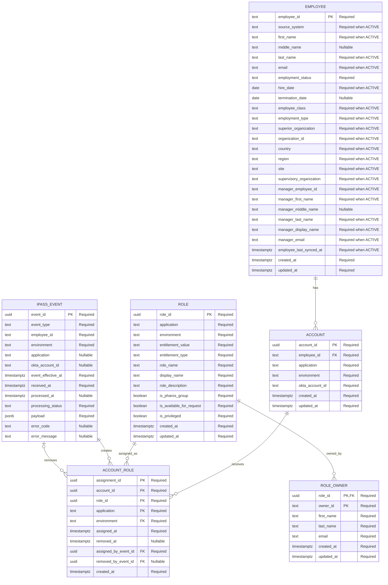

# Pharos ingestion ER diagram

All columns and PostgreSQL types match the fresh-install DDL. PK = primary key; FK = foreign key. Profile columns are conditionally required for ACTIVE employees.

## Keys and scope

- Account source key: application + environment + okta_account_id.
- Role source key: application + environment + entitlement_value.
- Owner key: role_id + owner_id. Owners need not have employee accounts.
- Current assignment: removed_at IS NULL; one per account/role. Role and account must match application/environment through composite foreign keys.
- Internal account_id, role_id and assignment_id are database-generated UUIDs; they are not payload fields.
- Event UUID is supplied by iPass. Event employee/account identifiers are not foreign keys because receipt can precede entity creation.
- Termination affects the employee and every linked account in the deployment. Normal snapshots affect only their account.

## Example identifiers

All identifiers below are fictional. Internal keys are database-generated UUIDs; source identifiers are opaque strings from iPass.

| Table | Internal key | Source identifier | Scope |
| --- | --- | --- | --- |
| account | account_id = b6d27ea0-f56a-4a7e-8df2-26a849b6c430 | okta_account_id = 00u8k3m5n7P2qRsTu0h7 | Okta / Prod |
| role | role_id = 19c852d7-e483-49f8-93b6-63fe09fc1ea4 | entitlement_value = 00g8n4q2r6T9vWxYz0h7 | Okta / Prod |
| role | role_id = 832ebfac-b653-4719-a124-e6f1026c58f9 | entitlement_value = 00g9p5s3u7V2xYaBc0h7 | Okta / Prod |

The KYC role is named APP_Pharos_Prod_KYC_Analyst; the GSI role is APP_Pharos_Prod_GSI_Analyst. Assignment rows reference account_id b6d27ea0-f56a-4a7e-8df2-26a849b6c430 and role_id 19c852d7-e483-49f8-93b6-63fe09fc1ea4 or 832ebfac-b653-4719-a124-e6f1026c58f9. iPass sends the source identifiers, never these internal UUIDs. Source identifiers do not encode the employee, role name, or environment.
